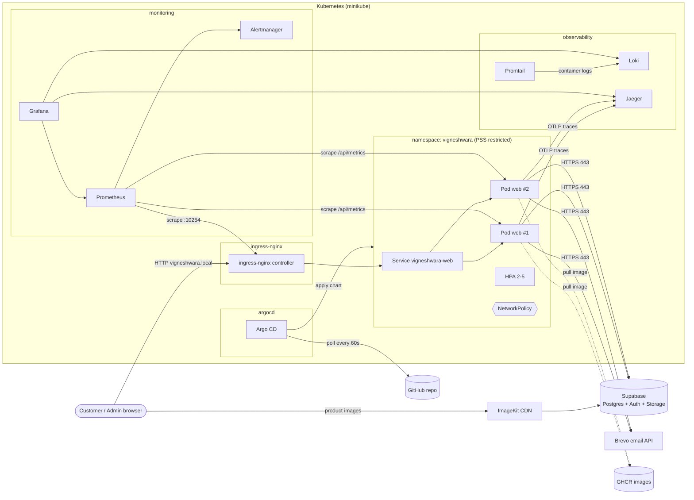

# Architecture

Vigneshwara Novelties is a catalogue and inquiry site for a jewellery / silver
articles shop. Customers browse products (English and Telugu) and send an
inquiry; there is no checkout. The owner manages products from `/admin`.

The application is a single Next.js 15 service. Data, auth and images live in
managed services (Supabase, ImageKit), so the service itself is **stateless**.

## Components

| Component | Role | Where |
|---|---|---|
| Next.js app (`vigneshwara-web`) | Storefront pages (ISR), admin UI, API routes | Deployment, 2-5 pods |
| ingress-nginx | Single entry point, routes by host, records request metrics | minikube addon |
| Supabase | Postgres (products, inquiries), Auth (admin login), Storage (photos) | External, managed |
| ImageKit | Resizes/caches product photos from Supabase Storage | External CDN, browser talks to it directly |
| Brevo | Sends the owner an email for each inquiry | External API |
| Prometheus / Grafana / Alertmanager | Metrics, dashboards, SLO alerts | `monitoring` |
| Loki + Promtail | Log storage and collection | `observability` |
| Jaeger | Trace storage and UI | `observability` |
| Argo CD | Keeps the cluster in sync with the chart in git | `argocd` |
| GitHub Actions + GHCR | CI pipeline and image registry | External |

## Request paths

**Browse a product (read path)**

1. Browser → `vigneshwara.local` → ingress-nginx (request counted, latency recorded).
2. ingress → Service → one ready pod (readiness probe decides which pods get traffic).
3. Next.js serves the page from its ISR cache. If the cached page is older than
   10 minutes it is served stale and regenerated in the background, querying
   Supabase through `unstable_cache` (60 s data cache).
4. Product images are not served by the pod: the HTML points at ImageKit,
   which fetches the original from Supabase Storage once and caches it.

**Send an inquiry (write path, the main user journey)**

1. Browser `POST /api/inquiry` → ingress → pod.
2. Validation (zod). Invalid → `422`. Honeypot filled → silently accepted.
3. Insert into Supabase `inquiries` with an idempotency key, so a retried
   request (offline queue in the browser) does not create a duplicate.
4. Email to the owner through Brevo. Failure is logged but does not fail the
   request, because the inquiry is already saved.
5. `app_inquiries_total{result=...}` is incremented and a JSON log line with the
   trace id is written. The whole request is one trace in Jaeger, with child
   spans for the Supabase and Brevo calls.

## Failure boundaries

| Failure | Effect | Containment |
|---|---|---|
| One pod crashes / hangs | Liveness probe restarts it; readiness removes it from the Service | 2+ replicas, PDB `minAvailable: 1`, rolling updates with `maxUnavailable: 0` |
| Bad release (crashes or fails readiness) | New pods never become ready | Old pods keep serving; rollout stalls; Argo CD shows Degraded; roll back by reverting the tag commit |
| Supabase down or slow | Inquiries fail (500), admin unusable | Catalog pages still served from ISR cache, because readiness does **not** depend on Supabase (otherwise every pod would go unready and the whole site would 503) |
| Brevo down | Owner gets no email | Inquiry still saved and visible in `/admin` |
| ImageKit down | Product images missing | Pages still load; it is outside the cluster |
| Observability stack down | No metrics/logs/traces | App is unaffected; export is fire-and-forget |
| Argo CD down | No new deployments | Running app is unaffected |
| Node (minikube) down | Full outage | Accepted limitation of a single-node local cluster |

## Networking

- Only ingress-nginx is reachable from outside the cluster (minikube IP, port 80).
- The Service is `ClusterIP`; pods are not exposed directly.
- NetworkPolicy (enforced by Calico) allows into the app pods only: the ingress
  controller, Prometheus (`monitoring`), and the smoke-test job. Out of the
  pods only: DNS, Jaeger OTLP (4318), and HTTPS (443) to public IPs. Private
  ranges are blocked, so a compromised pod cannot reach other workloads.
- Supabase, Brevo and ImageKit are reached over public HTTPS.

## State and data

The pods hold no data that matters. Writable paths are two `emptyDir`
volumes (`/tmp`, `/app/.next/cache`) that can be lost at any time; everything
else is read-only. All persistent state is in Supabase (backups are Supabase's
responsibility). Loki uses a small PVC for log retention (72 h).

A side effect of in-memory ISR: each pod has its own page cache. When the
admin edits a product, `revalidateTag` clears the cache only in the pod that
handled the admin request; other pods refresh within the TTL (60 s data, 10 min
pages). A shared cache handler (e.g. Redis) would fix this; it was not worth
the extra component for this shop.

## Configuration

| Kind | Where | How it reaches the pod |
|---|---|---|
| Public build-time values (`NEXT_PUBLIC_*`) | GitHub Actions variables | Docker build args, compiled into the JS bundle |
| Non-secret runtime config | `values.yaml` + `values-local.yaml` | ConfigMap → `envFrom` (pods restart on change via checksum annotation) |
| Secrets (Supabase service key, Brevo key, metrics token) | `.env.local` on the operator's machine | `create-app-secret.sh` → Kubernetes Secret → `envFrom` |
| Build-time secret (service key for pre-rendering) | GitHub Actions secret | BuildKit secret mount, not stored in any layer |
| Image version | `values-local.yaml` `image.tag` | Set by CI, applied by Argo CD |

Vercel (the existing production host) is untouched: the standalone output and
in-memory ISR settings only apply when `BUILD_STANDALONE=1`, which the
Dockerfile sets.
